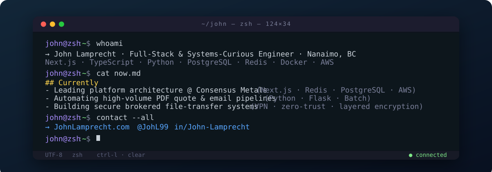

  

# Tech Stack

  

  <b>Frontend:</b> React · TypeScript · Next.js 
  <b>Backend:</b> Node.js · Python · PostgreSQL · Redis 
  <b>Infra:</b> Docker · AWS · NGINX

# What I Do

**I build full-stack applications that automate the boring parts of business. Data pipelines that process 500 documents a run, asset trackers that give teams back four hours a week, and secure systems that keep sensitive files safe on the internet.**

My day-to-day stack spans React and TypeScript on the frontend, Node and Python on the backend, and PostgreSQL or Redis for data. Usually containerized with Docker and deployed to AWS. I'm comfortable across the whole lifecycle, from database design and API design to responsive UIs and cloud infrastructure.

# A few things I've shipped

- At **Repautomate**, I built a Python-based quote pipeline that generated **500+ PDF quotes per run per user** dropping error rates below **1%**.
- At the **Regional District of Nanaimo**, I built an Excel VBA asset tracking system that saved my team about **four hours per week** and eliminated recurring inventory discrepancies.
- At **Consensus Metals**, I currently lead platform architecture development for a commercial metal-price prediction web app and API built on **Next.js**, **Redis**, **PostgreSQL**, **Docker**, **AWS**, and **NGINX**.

# Get in touch

  I'm a <b>2025 VIU Computer Science graduate</b> based in <b>Nanaimo, BC</b>. Open to developer roles <b>across Vancouver Island, Vancouver and remote</b>.

  
  

